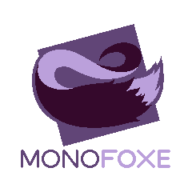



# What am I looking at?

This is Monofoxe - a game engine based on the [Monogame Framework](http://monogame.net).
Its main goal is to greatly simplify working with Monogame and to provide basic set of tools
enabling you to just *create a new project and make a damn game* without removing low-level access to the framework.
Monofoxe took a lot of inspiration from Game Maker, so it should be a bit familiar to some folks.

[](https://www.nuget.org/packages/Monofoxe.Engine) [View changelog](/CHANGELOG.md)

[Last stable release](https://github.com/Martenfur/Monofoxe/releases/latest)

[**View Docs**](Docs/README.md)

[**Join Monofoxe Discord**](https://discord.gg/F9tPYaD)

[**Troubleshooting**](#troubleshooting)

# Getting started

- Download and install [Visual Studio](https://visualstudio.microsoft.com/) and the [.NET 9 SDK](https://dotnet.microsoft.com/download) (or newer). The content project is built with it.
- Open Terminal and type

  ```bash
  dotnet new install monofoxe.template
  ```
- To create a new Monofoxe project, open Terminal and type

  ```bash
  dotnet new monofoxe -n YourProjectName
  ```
- Open `YourProjectName.sln` in Visual Studio, select `YourProjectName.DX` (for DirectX) or `YourProjectName.GL` (for OpenGL) project as a Startup project.
- If content fails to build, right-click on the project you're trying to run, and in the dropdown select `Open in Terminal`. Then in the terminal window run the following command:

  ```bash
  dotnet restore
  ```
- Run the project and you're good to go!

You can also check out the [basic feature demos](Samples/) or the [Docs](Docs/README.md) to learn the basics of Monofoxe.

# What can it do?

Everything Monogame does, plus:

* Hybrid EC.
* Scene system (with layers!).
* Useful math for collisions and other game stuff.
* Lightweight collision detection.
* Easy animation from sprite sheets.
* Tiled maps support.
* Timers, alarms, cameras, state machines, tilemaps, foxes!
* Input management.
* Coroutines.
* FMOD audio support (As a standalone [library](https://github.com/Martenfur/FmodForFoxes/)).
* Content Builder based resource management with automatic sprite atlases and Tiled map support.
* Texture packing.
* Sprite groups and dynamic graphics loading.
* Graphics pipeline and automated batch\vertex buffer management.
* Hot reload (VS and Rider only).

Coming in the future:

* Animated tiles and infinite tilemaps from Tiled.
* Particle system.
* More detailed documentation.
* More foxes.

# Can I use it in my p...

Yes. Monofoxe is licensed under MIT, so you can use it and its code in any shenanigans you want. Free games, commercial games, your own the-coolest-in-the-world engines - no payment or royalties required. Just please leave a credit. ; - )
(However, if you will be using FMOD, it has its own [license](https://fmod.com/licensing#faq), which is much less permissive than mine.)

# Should I use it?

yes

# I have suddenly started loving foxes and want to contribute

That's the spirit, but **don't forget to check out Codestyle.cs before contributing!**

You can contact me via email (`chaifoxes@gmail.com`), on [Twitter](https://x.com/the_fox_society) or on [Monofoxe Discord](https://discord.gg/F9tPYaD).

## The foxes who helped

- [MirrorOfSun](https://github.com/MirrorOfSUn)
- [Shazan](https://bitbucket.org/%7B07c29368-d971-4ab1-8ec5-1a89d56bfa43%7D/)
- [Ne1gh](https://github.com/Ne1gh-RR)

## Troubleshooting

### The game starts, but cannot find its content

Make sure the platform project has the `MonoGamePlatform` property set, imports `BuildContent.targets` from the content project, and that the [.NET 9 SDK](https://dotnet.microsoft.com/download) (or newer) is installed. Then build the platform project again - the content builder output is printed into the build log, and errors are reported with an `[E]` prefix.

If packages fail to restore, right-click on the project you're trying to run (not on the solution), select `Open in Terminal` and run:

```bash
dotnet restore
```

### Shaders fail to compile complaining about `libmojoshader_64.dll`

You're missing the `MS VS C++ Redistributable for 2013`. Download and install both x64 and x86 versions [here](https://www.microsoft.com/en-us/download/details.aspx?id=40784).
